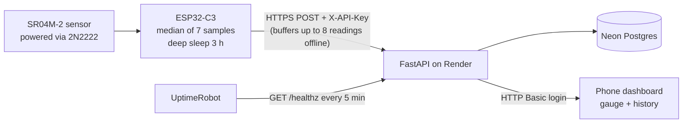

# Water Tank Monitor

<!-- add a screenshot of your dashboard here:  -->

Battery-powered underground water tank level monitor with a self-hosted cloud backend.

**Hardware:** ESP32-C3 SuperMini, SR04M-2 waterproof ultrasonic sensor (powered through a 2N2222 switch so it is off between readings), TP4056 + 2000 mAh LiPo.
**Backend:** FastAPI, Postgres (SQLite for local dev). **Dashboard:** Chart.js, served by the backend.
**Hosting:** Render (web service, Docker) + Neon (free Postgres).



## Run locally

```bash
python3 -m venv .venv && source .venv/bin/activate
pip install -r requirements.txt
export API_KEY="pick-a-long-random-string"
export EMPTY_DISTANCE_CM=600   # sensor reading with empty tank
export FULL_DISTANCE_CM=25     # sensor reading with full tank
uvicorn app:app --host 0.0.0.0 --port 8000
```

Without `DATABASE_URL`, readings go to a local `tank.db` (SQLite). Open `http://localhost:8000`.

## Deploy (Render + Neon)

1. **Database:** create a free project on Neon and copy its connection string (starts with `postgresql://`).
2. **Code:** push this folder to a GitHub repo.
3. **Server:** on Render choose New > Blueprint (reads `render.yaml`), or New > Web Service > Docker. Set the environment variables:

| Variable | Meaning |
|---|---|
| `API_KEY` | Secret the ESP32 sends in the `X-API-Key` header |
| `DASHBOARD_PASSWORD` | Password for viewing the dashboard (any username) |
| `DATABASE_URL` | Neon connection string |
| `EMPTY_DISTANCE_CM` / `FULL_DISTANCE_CM` | Tank calibration |
| `TZ_NAME` | Time zone for daily usage, default `Asia/Kolkata` |
| `STALE_HOURS` | Show a warning banner after this many hours without data (default 7) |

4. **Firmware:** open `esp_code/esp_code.ino`, set the 2.4 GHz Wi-Fi name/password, `SERVER_URL` and the same `API_KEY`, then flash. Never commit real secrets.

Free-tier notes: a Render free web service sleeps after 15 idle minutes and takes about a minute to wake, so the firmware waits up to 75 s for a response. An uptime pinger (UptimeRobot) hitting `/healthz` every 5 minutes keeps it awake, so the dashboard opens instantly and the node never waits for a cold start.

## Tests

```bash
pip install -r requirements.txt pytest httpx
pytest -q
```

15 tests cover API-key and dashboard auth, input validation, level calculation and clamping, late-delivered (buffered) readings, recalibration of old data, and the production guard against the default API key. They run on every push through GitHub Actions (`.github/workflows/tests.yml`).

## TLS (firmware)

The node always encrypts traffic. To also **verify** the server's certificate, paste the CA certificate into `ROOT_CA` in `esp_code.ino`:

```bash
openssl s_client -showcerts -connect <your-service>.onrender.com:443 </dev/null
```

Copy the last `-----BEGIN CERTIFICATE-----` block printed. With `ROOT_CA` filled in, the node syncs the time over NTP first (it forgets the date in deep sleep) and only sends when the certificate checks out; otherwise readings stay buffered. With `ROOT_CA` empty it prints a warning and skips verification.

## API

| Method | Path | Auth | Purpose |
|---|---|---|---|
| POST | `/api/readings` | `X-API-Key` | Ingest a reading (`distance_cm`, optional `rssi`, `age_s`) |
| GET | `/api/readings?hours=48` | dashboard password | History with computed level % |
| GET | `/api/latest` | dashboard password | Latest reading |
| GET | `/api/usage?days=7` | dashboard password | Estimated daily consumption |
| GET | `/healthz` | none | Liveness check |

Test without hardware:

```bash
curl -X POST localhost:8000/api/readings -H "X-API-Key: $API_KEY" \
  -H "Content-Type: application/json" -d '{"distance_cm":120,"rssi":-62}'
```

## Design notes

- Raw distance is stored; level % is computed at read time, so recalibrating fixes old data.
- Median filtering on the device rejects false echoes.
- The node buffers up to 8 unsent readings in RTC memory and sends them with an `age_s` offset, so a server or Wi-Fi outage leaves no gaps in the history.
- The node always returns to deep sleep, even when Wi-Fi fails; the sensor is powered off through a transistor between readings.
- Device and viewer credentials are separate; the server refuses to start in production with the default API key.
- Dashboard shows a warning banner when no data has arrived for several hours.

## Roadmap

- [ ] Temperature compensation for speed of sound
- [ ] Push alert for low level (Telegram)
- [ ] OTA firmware updates
- [ ] Battery voltage metering (designed with a switched divider, intentionally left out; the backend accepts `battery_v` and the dashboard shows it automatically if sent)
