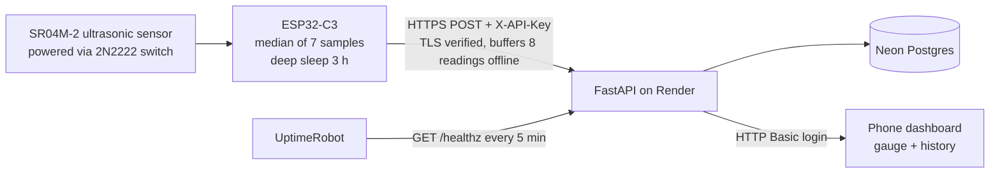

# Water Tank Monitor

[](https://github.com/pulkit-0715/water-tank-monitor/actions/workflows/tests.yml)

A battery-powered IoT system that measures the water level of an underground tank and shows it on a phone-friendly dashboard, from anywhere. Built end to end: sensor, firmware, cloud backend, database and web UI. No third-party IoT platform.

<!-- Add after mounting the device:


-->

**Why I built it:** the tank sits underground and is hard to check. My family used to guess when to run the pump. Now anyone with the link can see the level, and the node runs for weeks on one battery.

## Highlights

- **Full stack, owned end to end:** ESP32-C3 firmware (C++), FastAPI backend (Python), Postgres, and a dependency-light HTML/SVG dashboard served by the backend.
- **Designed for unreliable networks:** the node buffers unsent readings in RTC memory and uploads them later with an age offset, so Wi-Fi or server outages leave no gaps in history.
- **Low power by design:** the node wakes every 3 hours, powers the sensor through a transistor only while measuring, then deep-sleeps.
- **Secure by default:** separate credentials for device and viewers, constant-time key comparison, TLS with certificate verification on the device, and the server refuses to start in production with the default key. Secrets never live in Git.
- **Tested:** 15 automated API tests run on every push through GitHub Actions.
- **Deployed:** Render (web service) and Neon (Postgres), with an uptime monitor so the dashboard opens instantly.

## Architecture



## Hardware

| Part | Role |
|---|---|
| ESP32-C3 SuperMini | Microcontroller with Wi-Fi, deep sleep |
| SR04M-2 waterproof ultrasonic sensor | Distance to the water surface (trigger/echo mode, ~25 cm minimum range) |
| 2N2222 transistor, 1 kΩ and 10 kΩ resistors | Low-side switch that cuts power to the sensor between readings |
| TP4056 + 2000 mAh LiPo | Battery and charging |

Pins: sensor trigger on GPIO5, echo on GPIO4, sensor power switch on GPIO6.

## Engineering decisions

| Problem | Decision |
|---|---|
| Ultrasonic sensors return occasional false echoes | Median of 7 samples; out-of-range readings are discarded, so a failed measurement is never sent |
| Wi-Fi or the server can be down | Up to 8 readings are kept in RTC memory and sent later with `age_s`, so timestamps stay correct |
| Free hosting sleeps after 15 minutes idle | UptimeRobot pings `/healthz` every 5 minutes; the firmware also waits up to 75 s for a cold start |
| Recalibrating should not break history | Raw distance is stored; level % is computed when read, so a new calibration fixes old data |
| The ESP32 forgets the date in deep sleep, but TLS needs it | NTP sync before each upload, and readings stay buffered if sync fails |
| Hard-coded secrets leak through Git | Wi-Fi and API key live in `secrets.h`, which is git-ignored |
| A hobby API still needs real auth | `X-API-Key` for the device, HTTP Basic for viewers, constant-time comparison, no default key in production |

## Repository layout

```
app.py                      FastAPI backend and dashboard (single file)
esp_code/esp_code.ino       Firmware
esp_code/secrets.example.h  Template for Wi-Fi and API key (copy to secrets.h)
tests/test_api.py           API tests
.github/workflows/tests.yml CI
render.yaml                 Render Blueprint
Dockerfile, requirements.txt
```

## Run locally

```bash
python3 -m venv .venv && source .venv/bin/activate
pip install -r requirements.txt
export API_KEY="pick-a-long-random-string"
export EMPTY_DISTANCE_CM=230   # sensor reading with empty tank
export FULL_DISTANCE_CM=30     # sensor reading with full tank
uvicorn app:app --host 0.0.0.0 --port 8000
```

Without `DATABASE_URL`, readings go to a local SQLite file. Open `http://localhost:8000`.

Send a test reading without any hardware:

```bash
curl -X POST localhost:8000/api/readings -H "X-API-Key: $API_KEY" \
  -H "Content-Type: application/json" -d '{"distance_cm":120,"rssi":-62}'
```

## Deploy (Render + Neon)

1. **Database:** create a free Neon project and copy the connection string (`postgresql://...`).
2. **Code:** push this repository to GitHub.
3. **Server:** on Render choose New, then Blueprint (it reads `render.yaml`), and set the environment variables:

| Variable | Meaning |
|---|---|
| `API_KEY` | Secret the ESP32 sends in the `X-API-Key` header |
| `DASHBOARD_PASSWORD` | Password for viewing the dashboard (any username) |
| `DATABASE_URL` | Neon connection string |
| `EMPTY_DISTANCE_CM` / `FULL_DISTANCE_CM` | Tank calibration (sensor reading when empty / full) |
| `LOW_LEVEL_PCT` | Level below which the dashboard flags "low" (default 20) |
| `STALE_HOURS` | Show a warning after this many hours without data (default 7) |
| `TZ_NAME` | Time zone for daily usage, default `Asia/Kolkata` |

4. **Uptime monitor:** point UptimeRobot (or similar) at `https://<service>.onrender.com/healthz` every 5 minutes.

## Firmware setup

1. In Arduino IDE install the ESP32 boards package; choose **ESP32C3 Dev Module** and enable **USB CDC On Boot**.
2. Copy `esp_code/secrets.example.h` to `esp_code/secrets.h` and fill in the 2.4 GHz Wi-Fi name, password and the same `API_KEY` as the server.
3. Set `SERVER_URL` in `esp_code.ino`.
4. Test with `SLEEP_SECONDS = 60` and `TEST_MODE = true`; look for `Time sync: ok` and `POST -> 201` in the Serial Monitor.
5. For real use set `SLEEP_SECONDS = 3UL * 3600UL` and `TEST_MODE = false`.

### TLS

The node verifies the server certificate against the Google Trust Services **GTS Root R4** certificate embedded in `ROOT_CA` (valid until 2036). If the hosting provider ever changes certificate authority, replace it:

```bash
openssl s_client -showcerts -servername <host> -connect <host>:443 </dev/null
```

Left empty, `ROOT_CA` makes the node fall back to encrypted-but-unverified connections and print a warning.

## API

| Method | Path | Auth | Purpose |
|---|---|---|---|
| POST | `/api/readings` | `X-API-Key` | Ingest a reading (`distance_cm`, optional `rssi`, `age_s`) |
| GET | `/api/readings?hours=48` | dashboard password | History with computed level % |
| GET | `/api/latest` | dashboard password | Latest reading |
| GET | `/api/usage?days=7` | dashboard password | Estimated daily consumption |
| GET | `/healthz` | none | Liveness check |
| GET | `/` | dashboard password | Dashboard |

## Tests

```bash
pip install -r requirements.txt pytest httpx
pytest -q
```

The 15 tests cover API-key and dashboard auth, input validation, level calculation and clamping, late-delivered readings, recalibration of old data, and the production guard against the default API key. GitHub Actions runs them on every push.

## Calibration

Mount the sensor facing straight down, read the raw `distance_cm` from `/api/latest` when the tank is full and when it is empty, and set `FULL_DISTANCE_CM` and `EMPTY_DISTANCE_CM`. Because raw distances are stored, old readings update automatically.

## Results

<!-- Fill in with your own measurements after a few weeks of running:
- Reading interval: 3 hours
- Accuracy against a tape measurement: ±__ cm
- Readings delivered: __ % over __ days
-->

## Limitations and roadmap

- The speed of sound is fixed at 20 °C, so readings drift slightly with temperature.
- Battery voltage monitoring was designed (switched voltage divider) but left out on purpose to keep the hardware simple; the backend still accepts an optional `battery_v`.
- No push alerts yet. The dashboard flags a low level and a stale node, but does not message anyone.
- Possible next steps: Telegram low-level alert, temperature compensation, OTA firmware updates, certificate rotation checks.
